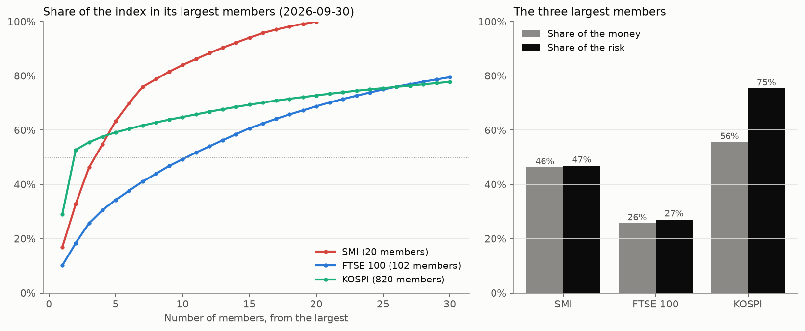
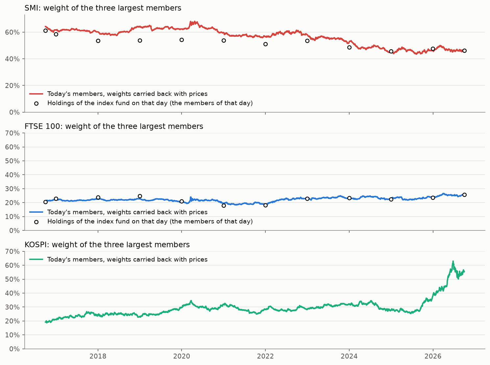
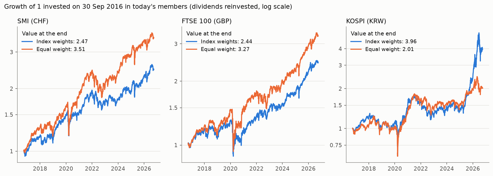
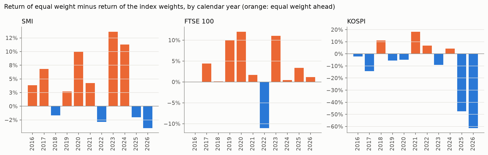
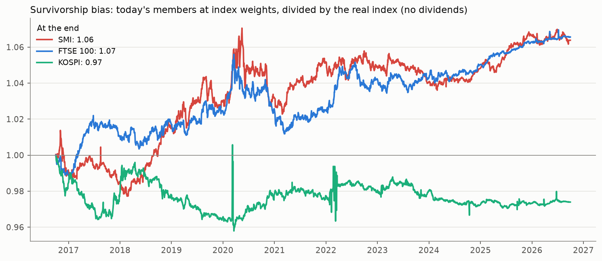

# A Few Companies Are Most of the Index: Index Weights Against Equal Weight in the SMI, the FTSE 100 and the KOSPI

**Question.** An index weighted by market value puts most of the money in its largest
companies. Three companies are 46% of the Swiss SMI and two are more than half of the
Korean KOSPI. How much of each index, and of its risk, sits in a few names, and what would
the same companies have given if they had been held in equal parts?

**Short answer (members and weights of 30 September 2026, held over the ten years before).**

| | SMI | FTSE 100 | KOSPI |
|---|---|---|---|
| Members | 20 | 102 | 820 |
| Weight of the 3 largest | 46.3% | 25.7% | 55.6% |
| Share of the index's risk in those 3 | 46.9% | 27.1% | 75.4% |
| Members needed to make half of the index | 4 | 11 | 2 |
| Effective number of members | 10.0 | 27.3 | 6.9 |
| Return per year at **index weights** | 9.5% | 9.3% | 15.2% |
| Return per year at **equal weight** | 13.5% | 12.5% | 7.5% |
| Equal weight minus index weights, in points (95% interval) | +4.0 (−0.6 to +8.9) | +3.2 (−0.7 to +7.6) | −7.7 (−21.4 to +4.6) |
| Can ten years tell them apart? | No | No | No |
| Weight of the 3 largest ten years ago → today | 64% → 46% | 21% → 26% | 19% → 56% |

The effective number of members is the number of equal positions that would be as
concentrated: the KOSPI has 820 members and is as concentrated as a portfolio of 7.

Other findings:
- **The three indices are concentrated in different things.** The SMI is three defensive companies (Roche, Novartis and Nestlé; health care is 42% of the index). The KOSPI is two makers of memory chips (Samsung Electronics and SK hynix are 53% of the money and 71% of the risk). The FTSE 100 is the least concentrated of the three.
- **Equal weight is a bet against the largest companies, and it wins or loses with them.** In Switzerland the weight of the three largest fell from 64% to 46% and equal weight was 4.0 points per year ahead. In Korea it rose from 19% to 56% and equal weight was 7.7 points behind: 47 points behind in 2025 and 61 in the first nine months of 2026.
- **None of the three differences can be told apart from zero.** Not even the 7.7 points per year of Korea: all of it comes from 2025 and 2026.
- **Equal weight did not lower risk.** It was more volatile than the index weights in the SMI and the FTSE 100 and had a deeper worst fall in all three markets.
- **The comparison is biased, and the size of the bias can be measured.** Only today's members are used. At index weights they did 0.7 points per year better than the real SMI and the real FTSE 100 and 0.3 worse than the real KOSPI. Equal weight is flattered more, and over twenty years the comparison is no longer usable. See [Limitations](#6-limitations).

Every number in this README comes from [`results/summary.md`](results/summary.md) or from the
detail files next to it. `python run_all.py` generates all of them.



---

## Contents
1. [Data](#1-data)
2. [Methodology](#2-methodology)
3. [Results](#3-results)
4. [Where the difference comes from](#4-where-the-difference-comes-from)
5. [Robustness](#5-robustness)
6. [Limitations](#6-limitations)
7. [How to reproduce](#7-how-to-reproduce)
8. [Repository structure](#8-repository-structure)
9. [References](#9-references)

---

## 1. Data

| What | Source | Notes |
|---|---|---|
| Members and weights of the SMI and the FTSE 100 | Holdings files of the iShares SMI ETF (CH) and the iShares Core FTSE 100 UCITS ETF | The fund of an index holds its members at their index weights. The file exists for any past day; the one of 30 September 2026 is used |
| Members of the KOSPI | Company list of the Korea Exchange (KIND) | The KOSPI contains every company of that market |
| Weights of the KOSPI | Computed: ordinary shares outstanding (Yahoo Finance) × price on 30 September 2026 | The KOSPI weighs each company by the market value of all its ordinary shares |
| Prices and dividends | Yahoo Finance: daily close and dividends | From June 2006. Returns are built from the two (see below) |
| The real indices | Yahoo Finance: `^SSMI`, `^FTSE`, `^KS11` | Without dividends. Used only to measure the survivorship bias |
| Risk-free rates | FRED: 3-month interbank rate of each country (OECD) | For the Sharpe ratios |

Only the companies that are in each index on 30 September 2026 are in the study. A company
that left an index before that day (Credit Suisse, for instance) is not. This is a choice of
the design and its cost is measured in [Limitations](#6-limitations).

| Index | Members in the source | Members used | Already trading on 30 Sep 2016 | Weight today of those |
|---|---|---|---|---|
| SMI | 20 | 20 | 16 | 92.7% |
| FTSE 100 | 103 | 102 | 91 | 96.5% |
| KOSPI | 825 | 820 | 685 | 88.0% |

A member that was listed later (Alcon, Sandoz, Galderma and Amrize in the SMI) comes into
the portfolios when it starts trading. The FTSE 100 has more than 100 lines because some
companies are being replaced; one line of the fund, Evraz, no longer trades and is left out.

### What was corrected

| Problem | What is done | Cases |
|---|---|---|
| Yahoo's adjusted close leaves out almost all the dividends of London shares (prices are in pence and the adjustment takes the dividends as pounds) | Returns are built from the close and the dividend of each day, for the three indices | All of them |
| The Korea Exchange does not let a share move more than 30% in a day. Larger moves in the data are splits, capital reductions or demergers that Yahoo did not record, or wrong prices | The return of the day is set to zero | 330 days in 20 years |
| A Korean share with more than three such moves since 2016 has a price history that cannot be trusted | It is left out | 5 companies. One of them would have been 14% of the index with the price that Yahoo shows |
| The first price of a new listing is often a reference price set before trading starts | The first day of every new listing is not used | All new listings |
| Spin-offs and rights issues that Yahoo records as a loss | Every one-day move above 10% (SMI) or 17% (FTSE 100) since 2016 was looked at. Four are corrected by hand: the spin-off of Amrize from Holcim, the demerger of Georgia Capital, and the rights issues of IAG and easyJet | [`config.py`](concentration/config.py) |
| Other wrong figures | Two returns set to zero, two price histories shortened and one week of prices put back on its scale, each with its reason | [`config.py`](concentration/config.py) |

Every return that was changed is listed in `results/tables/corrections_<index>.csv`, and the
largest moves that are left in the data in [`t0c_largest_moves`](results/tables/t0c_largest_moves.md).

Two checks say that the members, the weights and the returns are right:

- **Over the last year, today's members at index weights give the return of the real index**: 14.6% against 14.3% (SMI), 14.0% against 13.4% (FTSE 100) and 106.4% against 106.1% (KOSPI), with daily correlations of 0.995 or more.
- **The weight of the three largest members matches what the index fund really held**: 61.3% in the fund against 64.2% carried back for the SMI in September 2016, and 20.5% against 20.9% for the FTSE 100.

---

## 2. Methodology

Two portfolios are built for each index with the same companies, and held from
30 September 2016 to 30 September 2026 with dividends reinvested, in the currency of the
index.

**Index weights.** Each member weighs what it weighs in the index. The index weighs
companies by market value, so the weight of a share moves with its price. The weights are
known on the last day, $T$; going back, the weight of member $i$ on day $t$ is

```math
w_{i,t} = \frac{w_{i,T}\, P_{i,t} / P_{i,T}}{\sum_j w_{j,T}\, P_{j,t} / P_{j,T}}
```

where $P_{i,t}$ is its price (the number of shares is taken as constant). It is one
purchase that is never touched. Its return on day $t$, with $r_{i,t}$ the return of each
member with dividends, is

```math
r_{p,t} = \sum_i w_{i,t-1}\, r_{i,t}
```

Holding today's weights fixed for ten years instead would be a mistake: today's weights are
the *result* of those ten years. [Section 5](#5-robustness) shows what that mistake is worth.

**Equal weight.** The same amount in each of the $N$ members that are trading,
$w_i = 1/N$, put back to equal on the last trading day of March, June, September and
December. Each purchase or sale costs 10 basis points.

**Concentration** is measured in money and in risk:

```math
\text{Effective number of members} = \frac{1}{\sum_i w_i^2}
\qquad\qquad
\text{Share of the risk of member } i = \frac{w_i\, \mathrm{cov}(r_i, r_p)}{\mathrm{var}(r_p)}
```

The effective number is $N$ when all the weights are equal and 1 when there is a single
member. The shares of the risk add up to 1; they use the weights of 30 September 2026 and
the daily returns of the two years before it. The diversification ratio is the weighted
average volatility of the members divided by the volatility of the portfolio:

```math
\mathrm{DR} = \frac{\sum_i w_i\, \sigma_i}{\sigma_p}
```

**Is the difference real?** The return per year and the Sharpe ratio of equal weight minus
those of the index weights are given with a 95% interval, obtained by redrawing the days in
blocks of a month 5,000 times (a block bootstrap, in the spirit of Ledoit and Wolf, 2008).
An interval that contains 0 means that ten years of data cannot tell the two portfolios
apart.

All the choices are in [`concentration/config.py`](concentration/config.py).

---

## 3. Results

### How concentrated each index is

| Index | Members | Largest member | Largest 3 | Largest 10 | Members that make half | Effective number | Risk in the largest 3 | Largest sector |
|---|---|---|---|---|---|---|---|---|
| SMI | 20 | 16.9% | 46.3% | 84.0% | 4 | 10.0 | 46.9% | Health Care (42%) |
| FTSE 100 | 102 | 10.2% | 25.7% | 49.3% | 11 | 27.3 | 27.1% | Financials (28%) |
| KOSPI | 820 | 29.1% | 55.6% | 64.9% | 2 | 6.9 | 75.4% | Information Technology (61%) |

The largest members:

| SMI | Weight | FTSE 100 | Weight | KOSPI | Weight |
|---|---|---|---|---|---|
| Roche | 16.9% | HSBC | 10.2% | Samsung Electronics | 29.1% |
| Novartis | 15.8% | Shell | 8.2% | SK hynix | 23.7% |
| Nestlé | 13.5% | AstraZeneca | 7.3% | SK Square | 2.8% |
| ABB | 8.5% | Rolls-Royce | 4.9% | Samsung Electro-Mechanics | 2.1% |
| UBS | 8.5% | Unilever | 3.8% | LG Energy Solution | 1.6% |

In the SMI and the FTSE 100 the three largest members carry the same share of the risk as
of the money. In the KOSPI they carry much more, 75% against 56%: Samsung Electronics and
SK hynix are more volatile than the rest and move together. SK Square, the third, is a
holding company whose main asset is a fifth of SK hynix.

### It has not always been like this

| Day | SMI | SMI: the fund that day | FTSE 100 | FTSE 100: the fund that day | KOSPI |
|---|---|---|---|---|---|
| 30 Sep 2016 | 64.2% | 61.3% | 20.9% | 20.5% | 19.2% |
| End of 2018 | 63.9% | 53.8% | 22.7% | 24.7% | 23.0% |
| End of 2020 | 59.8% | 53.9% | 19.6% | 17.9% | 32.1% |
| End of 2022 | 58.1% | 53.6% | 23.0% | 22.8% | 28.2% |
| End of 2024 | 45.3% | 45.7% | 22.9% | 22.5% | 27.7% |
| End of 2025 | 46.2% | 47.6% | 24.2% | 23.7% | 37.8% |
| 30 Sep 2026 | 46.3% | 46.3% | 25.7% | 25.7% | 55.6% |

Weight of the three largest members. The first column of each index is today's members
with their weights carried back; "the fund that day" is what the index fund really held,
with the members the index had then. In the SMI the two differ between 2017 and 2023
because the index has capped each member at 18% since 2017, which the carried-back weights
do not know. In Korea, half of the rise happened in the last nine months.



### Index weights against equal weight

| Index | Portfolio | Return per year | Volatility | Sharpe ratio | Worst fall | Tracking error | Turnover per year |
|---|---|---|---|---|---|---|---|
| SMI | Index weights | 9.5% | 14.0% | 0.73 | −24.9% | – | 0% |
| SMI | Equal weight | 13.5% | 15.9% | 0.89 | −30.8% | 6.3% | 15% |
| FTSE 100 | Index weights | 9.3% | 14.1% | 0.55 | −32.7% | – | 0% |
| FTSE 100 | Equal weight | 12.5% | 15.6% | 0.70 | −36.8% | 5.9% | 18% |
| KOSPI | Index weights | 15.2% | 24.3% | 0.62 | −43.6% | – | 0% |
| KOSPI | Equal weight | 7.5% | 19.1% | 0.36 | −50.4% | 16.1% | 28% |

| Index | Return per year: equal minus index weights, points (95% interval) | Sharpe ratio: equal minus index weights (95% interval) |
|---|---|---|
| SMI | +4.0 (−0.6 to +8.9) | +0.15 (−0.10 to +0.43) |
| FTSE 100 | +3.2 (−0.7 to +7.6) | +0.15 (−0.08 to +0.38) |
| KOSPI | −7.7 (−21.4 to +4.6) | −0.25 (−0.80 to +0.26) |

Every interval contains 0. Equal weight moves far from the index: its tracking error is
6% per year in the SMI and the FTSE 100 and 16% in the KOSPI, where it has a beta of 0.59 to
the index. An investor measured against the index would have had years more than 10
points ahead in the two European indices, a year 11 points behind in the FTSE 100, and
years 47 and 61 points behind in Korea.

In the SMI and the FTSE 100, equal weight barely improves the diversification ratio (1.76
to 1.81 and 2.21 to 2.27). In the KOSPI it raises it from 1.38 to 2.23.



---

## 4. Where the difference comes from

| Index | Members | Average weight in the index | Average weight in equal weight | Part of the difference (points per year) |
|---|---|---|---|---|
| SMI | Largest 3 | 56.4% | 17.2% | −2.82 |
| SMI | Next 7 | 29.6% | 40.7% | +2.13 |
| SMI | The other 10 | 14.0% | 42.1% | +4.56 |
| FTSE 100 | Largest 3 | 21.5% | 3.1% | −2.45 |
| FTSE 100 | Next 7 | 23.6% | 7.3% | −1.22 |
| FTSE 100 | The other 92 | 54.9% | 89.6% | +6.84 |
| KOSPI | Largest 3 | 26.1% | 0.3% | −10.36 |
| KOSPI | Next 7 | 10.1% | 0.9% | −1.42 |
| KOSPI | The other 810 | 63.8% | 98.8% | +3.78 |

Members are ranked by their weight today. In the three markets equal weight lost by holding
less of the largest three and gained by holding more of the small members. What changes is
the size of each part: in Korea, having 0.3% instead of 26% in Samsung Electronics, SK hynix
and SK Square cost 10 points per year.

By calendar year, equal weight was ahead in 7 of 11 years in the SMI, in 10 of 11 in the
FTSE 100 and in 4 of 11 in the KOSPI (2016 and 2026 are not complete). It is ahead when
the weight of the largest members falls and behind when it rises: +13.6 and +11.3 points
in the SMI in 2023 and 2024, when the weight of the three largest fell by 6 and 8 points;
−11.0 in the FTSE 100 in 2022, when oil and banks rose; −47.4 and −61.3 in the KOSPI in
2025 and 2026.



---

## 5. Robustness

One choice is changed at a time. Return per year.

| Design | SMI: index / equal | FTSE 100: index / equal | KOSPI: index / equal |
|---|---|---|---|
| Baseline: 10 years, quarterly rebalance | 9.5% / 13.5% | 9.3% / 12.5% | 15.2% / 7.5% |
| Last 5 years | 7.1% / 9.9% | 13.5% / 14.3% | 20.2% / 3.0% |
| Last 15 years | 10.8% / 15.8% | 10.0% / 17.8% | 7.9% / 11.2% |
| Last 20 years | 6.0% / 10.6% | 5.7% / 15.8% | −2.1% / 11.8% |
| Equal weight rebalanced monthly | 9.5% / 13.6% | 9.3% / 12.4% | 15.2% / 7.7% |
| Equal weight rebalanced yearly | 9.5% / 13.5% | 9.3% / 13.1% | 15.2% / 7.7% |
| Costs: 0 basis points | 9.5% / 13.5% | 9.3% / 12.6% | 15.2% / 7.5% |
| Costs: 25 basis points | 9.5% / 13.4% | 9.3% / 12.5% | 15.2% / 7.4% |
| KOSPI: only the 200 largest members | | | 17.4% / 18.4% |

How often equal weight is rebalanced and what trading costs do not matter. The length of
the period does, and it should not be read as "equal weight wins in the long run". The
further back the start, the more today's members differ from the members the index had
then: the companies that are in the index today are the ones that grew, and equal weight
holds more of the ones that were small. The rows of 15 and 20 years, and the row with the
200 largest Korean companies of today, measure that bias more than they measure equal
weight.

**Why the weights are carried back.** Holding today's weights all along, instead of letting
them move with prices, would have shown this:

| Index | Index weights (carried back) | Today's weights held all along | Equal weight |
|---|---|---|---|
| SMI | 9.5% | 12.2% | 13.5% |
| FTSE 100 | 9.3% | 14.5% | 12.5% |
| KOSPI | 15.2% | 34.3% | 7.5% |

A portfolio with 53% in Samsung Electronics and SK hynix since 2016 returns 34% per year.
Nobody had those weights in 2016: the two companies were 19% of the index then, with the
third.

---

## 6. Limitations

- **Survivorship bias.** Only the companies that are in each index today are used. A company that was in the index in 2016 and has since left (Credit Suisse in the SMI) is in neither portfolio, and the ones that are there are, by construction, the ones that did well enough to stay or to get in. The bias of the index-weights portfolio is measured by comparing it with the real index, both without dividends:

  | Index | Last year | Last 3 years | Last 5 years | Last 10 years |
  |---|---|---|---|---|
  | SMI: today's members minus the real index (points per year) | +0.2 | +0.6 | +0.4 | +0.7 |
  | FTSE 100 | +0.6 | +0.9 | +0.9 | +0.7 |
  | KOSPI | +0.3 | −0.3 | −0.1 | −0.3 |

  It is small because the largest companies, which decide the return of an index, rarely leave it. **For equal weight the bias is larger and cannot be measured with this data**: a small company that failed and left the index would have weighed as much as Nestlé. The 4.0 and 3.2 points of the SMI and the FTSE 100 are therefore an upper limit of what equal weight gave, and the −7.7 of the KOSPI understates what it lost. The gap also includes changes in the number of shares, which the index-weights portfolio ignores.
- **The SMI caps each member at 18%** (since 2017). The carried-back weights do not know it and give the three largest up to 10 points more than the index had between 2017 and 2023.
- **The weights of the KOSPI are computed, not published.** They use Yahoo's count of ordinary shares; five companies have no count. The check against the real index says they are right on the whole, not for every company.
- **Korean prices are the weakest part of the data.** 330 impossible moves were set to zero and five companies left out. For the index weights this is irrelevant (they are small companies); for equal weight, where each of 820 companies weighs the same, it is not.
- **Equal weight in 820 Korean companies is not a real portfolio.** Many of them are too small to hold in size, and a flat cost of 10 basis points understates what trading them costs.
- **Corrections by hand may be incomplete.** Only moves above 10% (SMI) and 17% (FTSE 100) were looked at. Smaller corporate actions that Yahoo records badly remain.
- **Ten years, three markets, one outcome each.** The intervals say it: none of the three differences is distinguishable from zero. The Korean result is the story of two companies in two years.
- **Each index in its own currency.** Nothing here compares the three markets for one investor.
- **Dividends are reinvested without tax**, and the index-weights portfolio pays no costs.



---

## 7. How to reproduce

Requirements: Python 3.12 or later (tested with 3.14 on Windows 11).

```bash
git clone https://github.com/jaime-nieto/index-concentration.git
cd index-concentration
python -m venv .venv
.venv\Scripts\activate            # Linux / macOS: source .venv/bin/activate
pip install -r requirements.txt

pytest                            # 35 tests, a few seconds
python run_all.py                 # first run: a few minutes, most of it downloading
python run_all.py --refresh       # downloads everything again (about 10 minutes)
```

The first run downloads the holdings of the two funds at the end of each year and 950
price histories from Yahoo Finance. After that the project runs offline in a few seconds.
With `--refresh` it also downloads the Korean company list and 830 share counts, and
computes the weights of the KOSPI again. The price data are not in the repository because they belong to their
providers; [`data/raw/manifest.json`](data/raw/manifest.json) records the source and the
download date of every file. The members and weights of 30 September 2026 are in
[`data/reference/`](data/reference) as they came from the sources, and the ones used after
the checks in `results/tables/members_<index>.csv`. The fund files can be downloaded again
for the same day; the Korean share counts are the ones Yahoo had on the day of the
download, so a later `--refresh` can change the weights of the KOSPI slightly.

---

## 8. Repository structure

```
index-concentration/
├── run_all.py               the whole analysis, step by step
├── concentration/
│   ├── config.py            every choice: dates, sources, design, corrections
│   ├── data_download.py     members, weights, prices, indices and rates
│   ├── data_prep.py         from prices to clean returns
│   ├── portfolios.py        index weights and equal weight
│   ├── measures.py          concentration in money and in risk
│   ├── metrics.py           performance statistics and intervals
│   ├── plotting.py          the figures
│   └── reporting.py         the tables and results/summary.md
├── data/
│   ├── reference/           members and weights of each index on 30 September 2026
│   └── raw/                 downloaded data (not committed, except the manifest)
├── results/
│   ├── summary.md           every table, generated
│   ├── tables/              each table as CSV and Markdown, corrections, daily returns
│   └── figures/
├── tests/test_core.py       members, cleaning, portfolios, concentration, statistics
└── requirements.txt
```

---

## 9. References

- DeMiguel, V., Garlappi, L. and Uppal, R. (2009). Optimal Versus Naive Diversification: How Inefficient Is the 1/N Portfolio Strategy? *The Review of Financial Studies*, 22(5), 1915–1953.
- Bessembinder, H. (2018). Do Stocks Outperform Treasury Bills? *Journal of Financial Economics*, 129(3), 440–457.
- Brown, S., Goetzmann, W., Ibbotson, R. and Ross, S. (1992). Survivorship Bias in Performance Studies. *The Review of Financial Studies*, 5(4), 553–580.
- Choueifaty, Y. and Coignard, Y. (2008). Toward Maximum Diversification. *The Journal of Portfolio Management*, 35(1), 40–51.
- Ledoit, O. and Wolf, M. (2008). Robust Performance Hypothesis Testing with the Sharpe Ratio. *Journal of Empirical Finance*, 15(5), 850–859.
